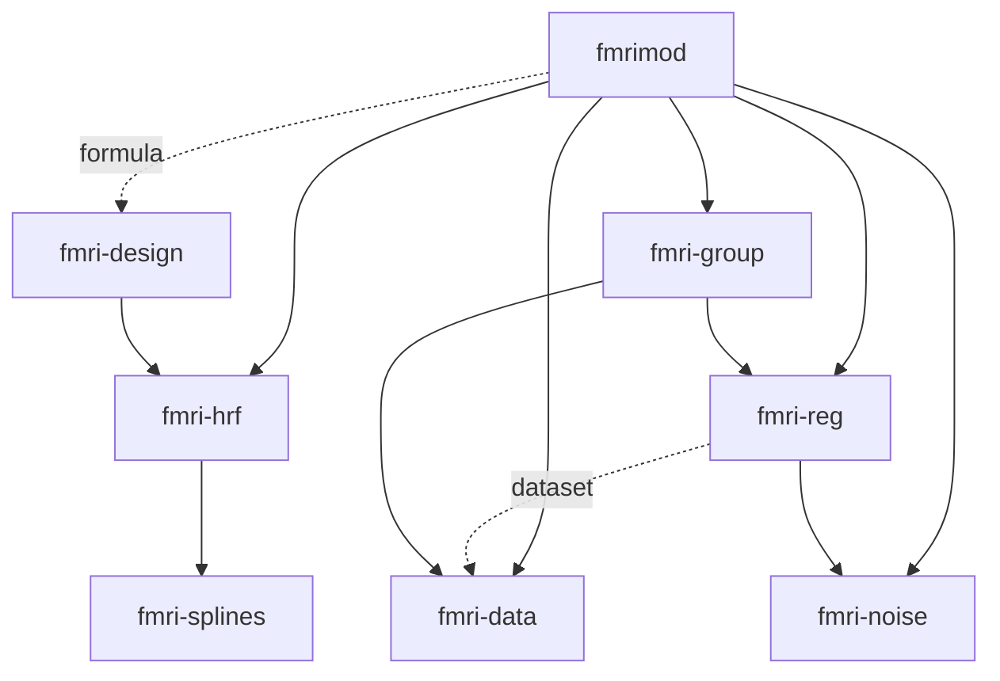

# Repository structure and naming

Subsequent source publication and hosted CI: [publication record](PUBLICATION.md).

The virtual Cargo workspace and flat `crates/` directory match the current
component boundaries. Each crate has one responsibility and the internal
dependency graph is acyclic. Keep the existing numerical boundaries.

## Names and public entry points

| Previous package | Current package | Rust import |
| --- | --- | --- |
| fmrihrf | fmri-hrf | fmri_hrf |
| fmridesign | fmri-design | fmri_design |
| fmridataset | fmri-data | fmri_data |
| fmrireg | fmri-reg | fmri_reg |
| fmri-noise | fmri-noise | fmri_noise |
| fmri-group | fmri-group | fmri_group |
| splines | fmri-splines | fmri_splines |
| fmrimod | fmrimod | fmrimod |

`fmrimod-rs` is the repository name. Packages omit the language suffix. The
component prefix makes the family recognizable, while `fmrimod` remains the
user-facing entry point. Its `hrf`, `dataset`, `regression`, `noise`, `group`, and
optional `design` reexports retain their short names.

The former generic `splines` name referred to a local implementation, not the
existing unrelated registry package. The new name removes that ambiguity.
[Registry lookups](../evidence/repository/registry-names.json) are a dated check,
not name reservations or a publication claim. Old Cargo package selectors and
Rust imports must be updated using the table above; compatibility aliases are
not added to this unpublished workspace.

## Dependency direction

Arrows mean “depends on”; dashed arrows require an optional feature.



Data identities remain independent of model fitting. Noise plans remain separate
from regression. Group models consume the data and regression layers. Spline
support remains a small independently tested numerical component. Polars stays
in the optional design frontend rather than entering the default facade path.

## Layout

```text
Cargo.toml / Cargo.lock  Shared metadata, dependency constraints and resolution
crates/<package>/       Cargo manifest, README, licenses, src/tests/examples
scripts/                Workspace checks, fixture generation and qualification
docs/                   Current guides, contracts and qualification reports
docs/history/           Clearly labelled imported plans and scratch material
evidence/               Reviewed receipts, numeric references and provenance
evidence/regression/    First-level performance and cohort receipts
.github/workflows/      Portable CI configuration
.mote/ops/              Portable project history; local authority is ignored
```

Raw generated logs, source snapshots and nested Git bundles are archived locally
and excluded from the current tree. Their original bytes remain in the baseline
Git history and a verified archive. The [evidence index](../evidence/README.md)
provides recovery instructions and hashes. This cleanup does not rewrite Git
history, so the initial push still carries the earlier objects.

## Package metadata and licensing

Version, edition, minimum tested Rust version, repository URL and publication
policy are shared through `[workspace.package]`. Common dependencies and internal
paths are declared once in `[workspace.dependencies]`. Features remain local to
the component that owns them. The declared Rust floor is the tested 1.91.1;
older toolchains have not been qualified.

Every package has an explicit source-package include list and its declared
license texts. The [license map](../LICENSE.md) preserves mixed licensing.
The repository URL names the intended GitHub destination; no remote is created
by setting this metadata. Registry publication is disabled for now.

These conventions follow Cargo's [workspace model](https://doc.rust-lang.org/cargo/reference/workspaces.html)
and [manifest rules](https://doc.rust-lang.org/cargo/reference/manifest.html).

## Local readiness check — 2026-10-27

The [verification receipt](../evidence/repository/checks.json) records:

- Default workspace: 1,025 passed, 0 failed, 16 ignored.
- All features from a fresh export of the staged Git tree: 1,054 passed,
  0 failed, 20 ignored. This checks that ignored local files are not required.
- Workspace formatting and numerical-library Clippy: passed.
- Eight package inventories and 51 current guide link checks: passed.
- `first_level`, `complete_first_level`, and `repeated_group`: ran successfully.
- No source drift during final verification; all 324 external dependency
  identities stayed unchanged.

[Source review](../evidence/repository/source-review.json) covered 150 production
Rust files: numerical algorithms are unchanged. Three shared reference fixtures
are mirrored byte-for-byte into package-local test directories; the repository
check verifies synchronization. A heuristic key/token-marker scan of reachable
history and staged blobs found no matches; it is not an exhaustive security audit.

The cleanup archives 1,217 generated/history files (about 121 MiB) from the current
tracked tree while retaining their local bytes and verified recovery sources.
The working source and curated evidence tree is about 37 MiB before final check
receipts. The Git history still contains the older objects.

The source tree is locally prepared for its first GitHub push. No GitHub remote
has been created, nothing has been pushed, and hosted CI has not run. Package
registry publication remains a separate release task.
